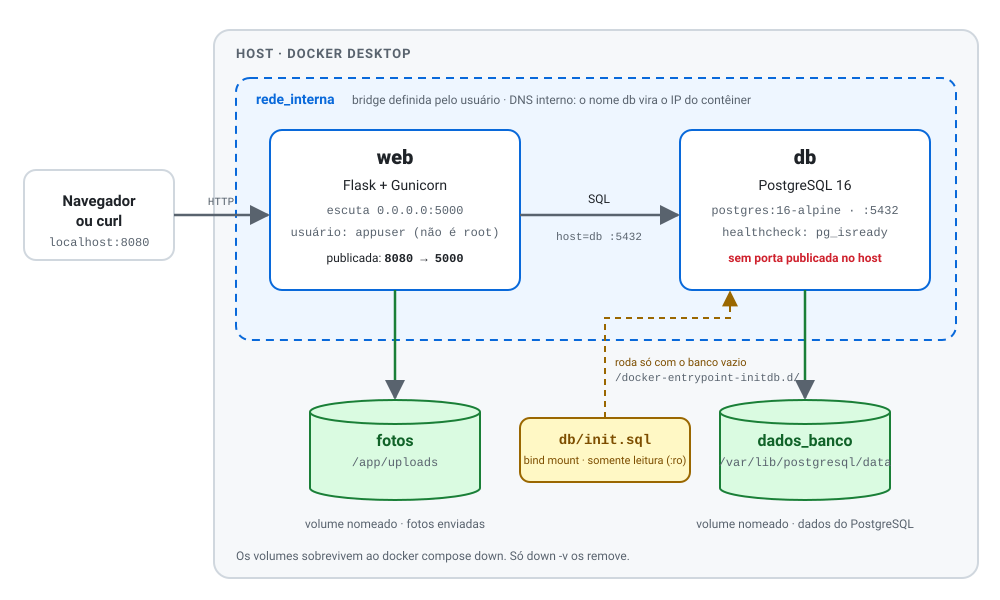
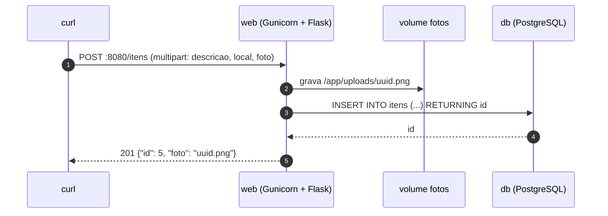
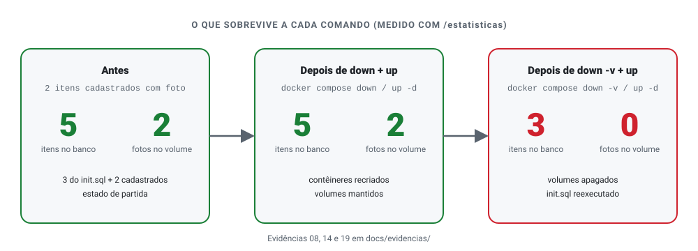
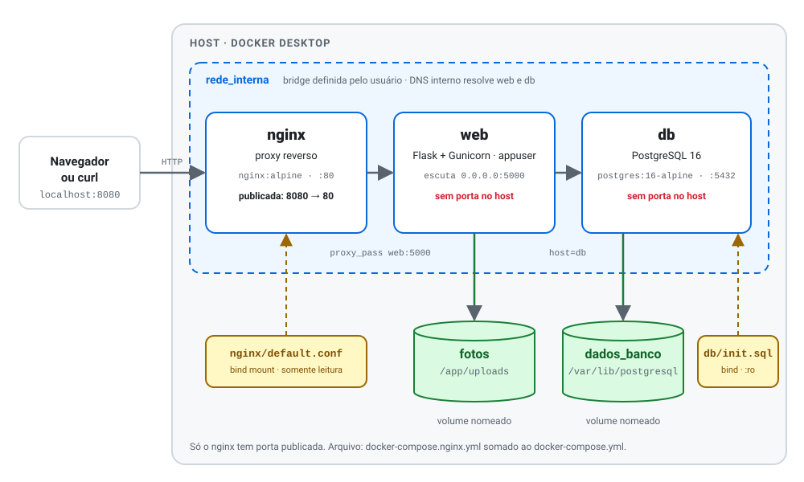

<div align="center">

# Achados & Perdidos

API de objetos perdidos em Flask e PostgreSQL, empacotada com Docker Compose.<br>Itens e fotos continuam lá depois de recriar os contêineres.


[Subir o ambiente](#subindo-em-um-minuto) ·
[Arquitetura](#arquitetura) ·
[Decisões](#decisões-de-projeto) ·
[Persistência](#persistência) ·
[Rotas](#rotas-da-api) ·
[Extras](#extras) ·
[Relatório](docs/RELATORIO.md) ·
[Reflexão](docs/REFLEXAO.md)

<sub>Avaliação de Grau 1 · Computação em Nuvem · Prof. Fábio Castro · CEULP/ULBRA, Palmas-TO</sub>

</div>

```bash
docker compose up -d --build
```

---

## O problema

O Setor de Atendimento ao Estudante guardava os objetos perdidos numa planilha compartilhada. Um estagiário escreveu uma aplicação web para substituí-la, mas ela só funcionava no notebook dele: o banco foi instalado à mão, as fotos ficavam numa pasta qualquer do disco e as senhas estavam anotadas num papel.

Este repositório é a primeira etapa da migração para a nuvem: colocar a aplicação e o banco em contêineres, para qualquer pessoa reproduzir o ambiente, e registrar por que cada peça existe, para a próxima equipe migrar sem precisar adivinhar.

## Subindo em um minuto

Único pré-requisito: **Docker** (Docker Desktop no Windows e macOS, ou Docker Engine com Compose v2 no Linux).

```bash
git clone https://github.com/jonasssgabriel/achados-perdidos.git
cd achados-perdidos

# 1. criar o arquivo de segredos a partir do modelo
cp .env.example .env            # Windows (cmd): copy .env.example .env

# 2. editar o .env e trocar POSTGRES_PASSWORD por uma senha sua

# 3. subir
docker compose up -d --build

# 4. conferir
docker compose ps               # db "healthy", web "running"
curl http://localhost:8080/health
```

Resposta esperada do último comando:

```json
{"banco":"conectado","container":"c5d2bdfdfeff","status":"ok"}
```

> [!IMPORTANT]
> O `.env` guarda a senha do banco e **não é versionado** (está no `.gitignore`). O repositório contém só o `.env.example`, com valores fictícios. No PowerShell use `curl.exe`, porque `curl` é um apelido de outro comando.

| Comando | O que acontece | Dados |
|---|---|---|
| `docker compose down` | Remove contêineres e rede | **Mantidos** nos volumes |
| `docker compose down -v` | Remove também os volumes | **Apagados** (itens e fotos) |

## Arquitetura

<picture>
  <source media="(prefers-color-scheme: dark)" srcset="docs/img/arquitetura-dark.svg">
  
</picture>

Do seu computador só o `web` é alcançável. O banco existe apenas dentro da `rede_interna`, onde o DNS do Docker resolve o nome `db`. No diagrama, azul é rede e serviço, verde é armazenamento persistente e amarelo é um arquivo do projeto montado no contêiner.

### O caminho de um `POST /itens` com foto



A foto vai para o disco (volume) e o registro vai para o banco. O nome do arquivo é um UUID gerado pela aplicação, para duas fotos com o mesmo nome original nunca se sobrescreverem.

## Decisões de projeto

<details open>
<summary>Imagem e Dockerfile</summary>

| Decisão | Por quê | O que quebraria sem ela |
|---|---|---|
| `python:3.12-slim` | Imagem oficial e enxuta: menos tamanho e menos superfície de ataque | Imagem maior, ou instalar Python à mão |
| `requirements.txt` copiado **antes** do código | Cache de camadas: mudar só o `app.py` não refaz o `pip install` | Todo build baixaria as dependências de novo |
| `pip install --no-cache-dir` | O cache do pip não precisa ficar na imagem | Imagem maior sem ganho |
| Usuário `appuser` (sem root) | Se a aplicação for comprometida, o invasor não é administrador do contêiner | `whoami` retornaria `root` |
| `CMD` em forma *exec* | O Gunicorn vira o processo principal e recebe o sinal do `docker stop` | Parada lenta ou forçada |
| Gunicorn em `0.0.0.0:5000` | Escutar em todas as interfaces do contêiner | A porta publicada não responderia |
| `.dockerignore` com `.env` | O `.env` não entra no contexto de build | A senha poderia ir parar dentro da imagem |

</details>

<details open>
<summary>Compose, rede e volumes</summary>

| Decisão | Por quê | O que quebraria sem ela |
|---|---|---|
| Rede `rede_interna` definida pelo usuário | Só em redes assim o Docker resolve contêineres pelo **nome** | `web` não encontraria `db` pelo nome |
| Volume nomeado `dados_banco` | O Docker gerencia o armazenamento; o banco sobrevive à recriação | Dados somem junto com o contêiner |
| `init.sql` como bind mount `:ro` | É um arquivo do projeto, versionado no Git; o contêiner só lê | A tabela precisaria ser criada à mão |
| `healthcheck` com `pg_isready` | "Iniciado" não é "pronto para aceitar conexões" | `depends_on` esperaria só o processo existir |
| `depends_on: service_healthy` | `web` só inicia depois do banco saudável | A primeira conexão poderia falhar |
| Sem `ports:` no `db` | O banco não precisa ser acessível de fora | Porta 5432 exposta no host |
| `.env` fora do Git | Credenciais não são versionadas | A senha vazaria no repositório |
| `restart: unless-stopped` | Religa após falha ou reinício do Docker, mas respeita uma parada manual | Serviço ficaria fora do ar |

</details>

## Persistência

<picture>
  <source media="(prefers-color-scheme: dark)" srcset="docs/img/persistencia-dark.svg">
  
</picture>

Os números foram medidos neste ambiente com `GET /estatisticas` antes de cada passo (arquivos em [`docs/evidencias/`](docs/evidencias/)).

O `init.sql` só roda quando o diretório de dados do PostgreSQL está vazio. Por isso os 3 itens de exemplo reaparecem depois de `down -v`, e por isso editar o `init.sql` não muda um banco que já existe. Os itens cadastrados à mão só existiam no volume; apagado o volume, acabaram.

### Uma foto servida pelo ambiente

<div align="center">
  
  <br>
  <sub><code>GET /fotos/&lt;nome&gt;</code> devolvendo a foto gravada no volume <code>fotos</code></sub>
</div>

## Rotas da API

| Método | Rota | O que faz |
|---|---|---|
| `GET` | `/health` | Responde `status: ok` e `banco: conectado` se o banco responde a um `SELECT 1` |
| `GET` | `/itens` | Lista os objetos; `?local=texto` filtra por local, sem diferenciar maiúsculas |
| `POST` | `/itens` | Cadastra um objeto. Campos: `descricao`, `local` e `foto` (opcional, multipart) |
| `GET` | `/fotos/<nome>` | Devolve a foto armazenada |
| `GET` | `/estatisticas` | Total de itens no banco e de fotos no volume |

```bash
curl "http://localhost:8080/itens?local=biblio"
curl -F descricao="Oculos de grau" -F local="Bloco B" -F foto=@oculos.jpg http://localhost:8080/itens
curl http://localhost:8080/estatisticas
```

## Extras

Os três desafios bônus da prova estão feitos e documentados em [`docs/EXTRAS.md`](docs/EXTRAS.md), sem alterar o ambiente principal:

| Extra | Como usar | Evidências |
|---|---|---|
| Adminer, painel do banco, num profile | `docker compose --profile debug up -d` e abrir `localhost:8081` | 24 a 26 |
| Backup e restauração do volume `fotos` em `.tar.gz` | Contêiner temporário com `docker run --rm` | 27 a 29 |
| nginx na frente do `web`, que deixa de publicar porta | `docker compose -f docker-compose.yml -f docker-compose.nginx.yml up -d` | 30 a 32 |
| Página web de teste, servida pelo nginx (lista, filtro, cadastro com foto e terminal que mostra o `curl` de cada ação) | Com o nginx no ar, abrir `http://localhost:8080/` | 33 |

<picture>
  <source media="(prefers-color-scheme: dark)" srcset="docs/img/arquitetura-nginx-dark.svg">
  
</picture>

## Segurança

- Nenhuma senha no `Dockerfile`, no `docker-compose.yml` ou no código: tudo vem do `.env`.
- O `web` executa como `appuser`: `docker compose exec web whoami` retorna `appuser`.
- O banco não tem porta publicada: `curl http://localhost:5432` falha, e `docker compose ps` mostra `5432/tcp` sem mapeamento para o host.
- O `.dockerignore` impede que `.env` e `__pycache__` entrem no contexto de build.

## Verificação rápida

<details>
<summary>Comandos para conferir o ambiente</summary>

```bash
docker compose ps                    # db: healthy, web: running, só a 8080 publicada
docker compose exec web whoami       # appuser
docker compose exec web ls -l /app/uploads
docker volume ls
docker network inspect achados-perdidos_rede_interna
docker image ls achados-perdidos-web # cerca de 54 MB de conteúdo (219 MB em disco no Docker Desktop)
```

</details>

## Estrutura do repositório

```
achados-perdidos/
├── app/
│   ├── app.py              # aplicação Flask (fornecida)
│   ├── requirements.txt    # Flask, psycopg, Gunicorn (fornecido)
│   ├── Dockerfile          # receita da imagem do serviço web
│   └── .dockerignore
├── db/
│   └── init.sql            # cria a tabela itens e 3 exemplos (fornecido)
├── nginx/
│   ├── default.conf        # configuração do proxy reverso (extra)
│   └── site/index.html     # página web de teste da API (extra)
├── docs/
│   ├── img/                # diagramas em SVG (claro e escuro)
│   ├── evidencias/         # saídas reais dos testes, com legenda
│   ├── arquitetura.md      # diagrama de arquitetura em Mermaid e SVG
│   ├── RELATORIO.md        # relatório técnico
│   ├── REFLEXAO.md         # questões de reflexão e equivalência em nuvem
│   ├── ROTEIRO-DEMO.md     # sequência de comandos para demonstrar o ambiente
│   └── EXTRAS.md           # desafios bônus: Adminer, backup e nginx
├── docker-compose.yml      # orquestração: serviços, rede, volumes
├── docker-compose.nginx.yml # sobreposição que põe o nginx na frente (extra)
├── .env.example            # modelo de configuração (sem senha real)
├── .gitignore              # mantém o .env fora do Git
└── README.md
```

## Limitações conhecidas

Este é um protótipo local. Ao migrar para a nuvem, estas peças mudam:

- **Réplicas:** o `web` é um único contêiner. Rodar várias réplicas exige remover a porta fixa 8080 (colisão) e colocar um balanceador na frente. As fotos precisariam de armazenamento compartilhado, como um serviço de objetos, e não de um volume local.
- **Banco:** um PostgreSQL em contêiner com volume local não tem alta disponibilidade nem backup automático. Na nuvem, o natural é um PostgreSQL gerenciado.
- **Segredos:** o arquivo `.env` seria substituído por um serviço de segredos do provedor.
- **Migrações:** alterar o esquema de um banco existente exige `ALTER TABLE` ou uma ferramenta de migração. O `init.sql` não faz isso.

A comparação detalhada com Azure, AWS e Google Cloud está em [`docs/REFLEXAO.md`](docs/REFLEXAO.md).
