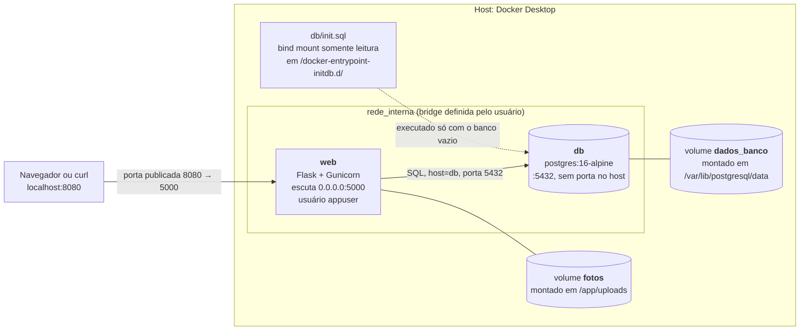
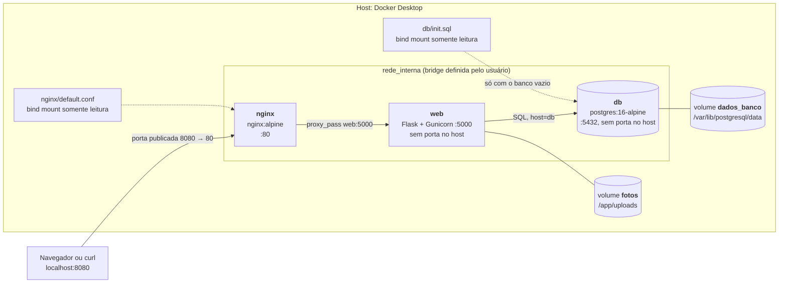

# Diagrama de arquitetura

Mostra o host, a porta publicada, os dois contêineres, a rede, os dois volumes (com o caminho de montagem de cada um) e o bind mount do `init.sql`. Dentro do retângulo `rede_interna` está tudo que fica na rede interna; fora dela ficam o cliente, os volumes e o arquivo do projeto.

## Ambiente do enunciado (`docker compose up -d --build`)

| Elemento | Dentro da rede interna? | Porta publicada no host |
|---|---|---|
| `web` | Sim | 8080 (para a 5000 do contêiner) |
| `db` | Sim | nenhuma |
| Volumes `fotos` e `dados_banco` | Não são rede; são armazenamento do Docker | n/a |
| `db/init.sql` | Não; é um arquivo do projeto montado no `db` | n/a |

<picture>
  <source media="(prefers-color-scheme: dark)" srcset="img/arquitetura-dark.svg">
  
</picture>

## Com nginx na frente (extra da seção 6)

Usa o arquivo `docker-compose.nginx.yml` somado ao principal. O `web` deixa de publicar porta, e só o `nginx` expõe a 8080.

Neste modo o nginx também entrega a página de teste (`nginx/site/index.html`) na rota `/`, montada como bind mount somente leitura em `/usr/share/nginx/html`. As demais rotas seguem para o `web`.

<picture>
  <source media="(prefers-color-scheme: dark)" srcset="img/arquitetura-nginx-dark.svg">
  
</picture>
